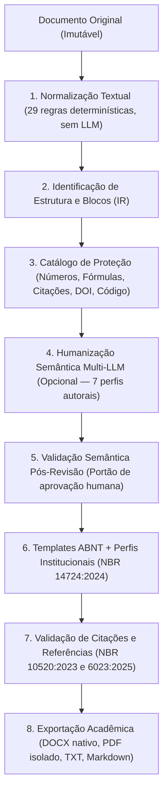

# Humaniza Acadêmico

[](LICENSE)
[](backend/pyproject.toml)
[](backend/app/main.py)
[](frontend/package.json)
[](docs/standards/ABNT_NORMS_RESEARCH.md)
[](docs/waves/onda-8.md)

Plataforma web modular para **normalização textual determinística**, **humanização semântica com proteção de dados científicos** e **formatação/validação acadêmica ABNT** em português brasileiro, com exportação nativa para **DOCX**, **PDF**, **TXT** e **Markdown**.

- **Autor:** **Renato Lemes Peixoto ([@realzurr](https://github.com/realzurr))**
- **Licença:** [MIT License](LICENSE)
- **Créditos de referência:** inspirado inicialmente na concepção de limpeza textual do projeto [`takumar-x/AI-Humanizer`](https://github.com/takumar-x/AI-Humanizer) (`takumar-x` / Mikhail Medvedev) — integralmente projetado e reimplementado do zero (*clean-room*) e expandido para o ciclo acadêmico completo.

> [!NOTE]
> **Estado atual do projeto:** **Onda 8 concluída** — todas as oito ondas do plano foram entregues: normalização textual, integração multi-LLM, humanização semântica, templates ABNT, validação de citações/referências, exportação DOCX/PDF/TXT/Markdown, interface web com 11 páginas e editor comparativo, e segurança/estabilização (autenticação, isolamento por usuário, uploads seguros, rate limiting e persistência relacional). Consulte o progresso detalhado em [`docs/ROADMAP.md`](docs/ROADMAP.md).

---

## Sumário

1. [Visão geral e pipeline](#1-visão-geral-e-pipeline)
2. [Funcionalidades principais](#2-funcionalidades-principais)
3. [Endpoints da API v1](#3-endpoints-da-api-v1)
4. [Arquitetura e estrutura do repositório](#4-arquitetura-e-estrutura-do-repositório)
5. [Início rápido (ambiente local)](#5-início-rápido-ambiente-local)
6. [Configuração (`.env`)](#6-configuração-env)
7. [Estado das ondas de desenvolvimento](#7-estado-das-ondas-de-desenvolvimento)
8. [Documentação técnica](#8-documentação-técnica)
9. [Autoria, créditos de referência e licença](#9-autoria-créditos-de-referência-e-licença)

---

## 1. Visão geral e pipeline

O usuário insere ou importa um documento acadêmico e percorre um **pipeline modular em etapas independentes**, operando sempre sobre uma Representação Intermediária imutável (`AcademicDocument`):



### Princípios fundamentais de engenharia

| Princípio | Garantia técnica |
|---|---|
| **Normalização e formatação sem LLM** | 100% determinístico, reprodutível e sem custo de API |
| **Documento original imutável** | `original_text` nunca é sobrescrito; cada etapa gera uma `DocumentRevision` rastreável |
| **A LLM nunca define layout** | Margens, paginação, numeração progressiva (NBR 6024) e estilos vêm exclusivamente de templates YAML |
| **Proteção de dados científicos** | Valores numéricos, estatísticas, equações, citações literais e DOIs são mascarados (`⟦P0001⟧`) antes da LLM e validados na saída |
| **Conformidade declarada por regra** | Cada regra aponta norma, edição, seção e grau de confiabilidade — sem promessas genéricas |
| **Zero invenção de metadados** | Referências ausentes são reportadas (nunca inventadas) e a ficha catalográfica é estritamente reservada |

---

## 2. Funcionalidades principais

- **Motor de Normalização Textual (`app/services/normalizer/`)**:
  - 29 regras configuráveis (remoção de caracteres invisíveis `ZWSP`/`BIDI`, normalização Unicode `NFC`/`NFKC` com proteção de superíndices científicos como `10⁻⁶`, `CO₂`, limpeza segura de Markdown, preservação de setas químicas e símbolos `©`/`®`/`™`).
- **Integração Multi-LLM (`app/services/providers/`)**:
  - Contrato único `LLMProvider` com adaptadores para **OpenAI**, **Anthropic (Claude)**, **Google Gemini**, **Ollama (local, sem chave)** e endpoints **OpenAI-compatíveis**, com retry exponencial, respeito a `Retry-After`, estimativa de custo e redação automática de segredos em logs.
- **Humanização Semântica e Validador (`app/services/humanizer/` e `semantic_validator/`)**:
  - 7 perfis de escrita (Acadêmico Científico, Acadêmico Acessível, Profissional, Institucional, Narrativo, Conversacional e Autoral Personalizado), controle de intensidade (`0..100`) e bloqueio automático de aprovação em caso de omissão ou alteração de entidade protegida.
- **Sistema de Templates ABNT (`app/services/academic/` e `templates/`)**:
  - 8 templates ABNT versionados (`general`, `tcc`, `dissertations`, `theses`, `monographs`, `articles`, `research_projects`, `reports`) e perfis institucionais (`UFMS`, `UFGD`), com resolução por precedência (`instituição > template > norma`) e registro explícito de conflitos normativos.
- **Validador de Citações e Referências (`app/services/references/`)**:
  - Parsing e validação conforme **ABNT NBR 10520:2023** e **ABNT NBR 6023:2025**, pareamento citação ↔ referência com grau de confiança, importação de **BibTeX** e **CSL-JSON**, e consulta *opt-in* de metadados de DOI via Crossref com geração de propostas para aprovação humana.
- **Exportação Nativa de Documentos (`app/services/document_export/`)**:
  - Geração de **DOCX** com estilos nativos do Word (`Heading 1..4`, `Normal`, `Citacao Longa`, `Legenda`, `Fonte`, `Referencia`, `Sem Indicativo`) e campos OpenXML reais (`TOC`, `PAGE`, `NUMPAGES`, `SEQ`, `STYLEREF`, `REF`), **PDF** renderizado em subprocesso isolado (LibreOffice Headless) com comparador estrutural `compare_docx_and_pdf`, além de **TXT**, **Markdown**, pré-visualização e histórico de versões.

---

## 3. Endpoints da API v1

| Método | Rota | Descrição | Onda |
|---|---|---|---|
| `GET` | `/api/v1/health` | Estado de saúde e versão da API | 0 |
| `POST` | `/api/v1/normalize` | Normaliza texto sem LLM e retorna relatório por regra e entidades protegidas | 1 |
| `GET` | `/api/v1/providers` | Lista provedores de LLM e status de configuração (`configured`, `last4`) | 2 |
| `GET` | `/api/v1/providers/{id}/models` | Lista modelos disponíveis no provedor selecionado | 2 |
| `POST` | `/api/v1/providers/{id}/credentials` | Registra credencial de provedor em sessão/cofre sem expor o segredo | 2 |
| `POST` | `/api/v1/humanize` | Executa humanização semântica com máscara de proteção e validação pós-LLM | 3 |
| `GET` | `/api/v1/templates` | Lista templates ABNT e perfis institucionais disponíveis | 4 |
| `GET` | `/api/v1/templates/{id}/resolve` | Resolve template com perfil institucional e lista conflitos normativos | 4 |
| `POST` | `/api/v1/academic/validate` | Valida citações (NBR 10520:2023) e referências (NBR 6023:2025) com relatório auditável | 5 |
| `POST` | `/api/v1/exports` | Gera e armazena exportações (`docx`, `pdf`, `txt`, `md`) com inspeção estrutural | 6 |
| `POST` | `/api/v1/exports/preview` | Gera pré-visualização estruturada (sumário, estilos, margens e blocos) | 6 |
| `GET` | `/api/v1/exports/{id}/download` | Faz o download do arquivo exportado (`.docx`, `.pdf`, `.txt`, `.md`) | 6 |
| `POST` | `/api/v1/auth/register` | Registra um usuário (senha PBKDF2) | 8 |
| `POST` | `/api/v1/auth/token` | Autentica e emite token de acesso assinado | 8 |
| `GET` | `/api/v1/auth/me` | Devolve o usuário autenticado | 8 |
| `POST` | `/api/v1/uploads` | Upload seguro de documento (tamanho, tipo real, nome sanitizado) | 8 |
| `POST` | `/api/v1/documents` | Cria um documento persistido (texto original imutável, isolado por dono) | 8 |
| `GET` | `/api/v1/documents` | Lista os documentos do usuário | 8 |
| `GET` | `/api/v1/documents/{id}` | Consulta um documento do usuário | 8 |
| `DELETE` | `/api/v1/documents/{id}` | Exclui um documento do usuário | 8 |
| `POST` | `/api/v1/documents/prune` | Aplica a política de retenção sobre os documentos | 8 |

---

## 4. Arquitetura e estrutura do repositório

```text
.
├── backend/                        # API FastAPI (Python 3.12+)
│   ├── app/
│   │   ├── api/v1/                 # Rotas HTTP (/api/v1/*)
│   │   ├── core/                   # Configuração, logging com redact_secrets e erros de domínio
│   │   ├── ir/                     # Representação Intermediária imutável (AcademicDocument, Block, Span)
│   │   ├── models/                 # Modelos ORM (SQLAlchemy 2.0)
│   │   ├── repositories/           # Camada de persistência
│   │   ├── schemas/                # Contratos Pydantic v2 de entrada/saída
│   │   └── services/
│   │       ├── normalizer/         # Onda 1 — Limpeza determinística sem LLM (29 regras)
│   │       ├── providers/          # Onda 2 — Adaptadores OpenAI, Anthropic, Gemini, Ollama
│   │       ├── humanizer/          # Onda 3 — Perfis de escrita, intensidade e análise estilística
│   │       ├── semantic_validator/ # Onda 3 — Catálogo de proteção, máscara e validação semântica
│   │       ├── academic/           # Onda 4 — Estrutura, numeração NBR 6024, paginação e estilos
│   │       ├── references/         # Onda 5 — Citações NBR 10520, referências NBR 6023, BibTeX/CSL/DOI
│   │       └── document_export/    # Onda 6 — DOCX nativo, campos Word, PDF isolado, TXT/MD e histórico
│   └── tests/                      # Suítes unit/, integration/ e regression/ (423 testes)
├── frontend/                       # SPA React 18 + TypeScript + Vite + Tailwind CSS
│   └── src/{components,pages,services,hooks,types,styles,utils}
├── templates/                      # Templates ABNT parametrizados (YAML) e JSON Schema
│   ├── abnt/                       # general, articles, tcc, monographs, dissertations, theses, reports...
│   ├── institutions/               # Perfis institucionais (UFMS, UFGD)
│   └── schemas/                    # Schema de validação dos templates
├── docs/                           # Documentação arquitetural, ADRs, normas e relatórios de onda
├── AGENTS.md                       # Regras permanentes de engenharia e qualidade
├── LICENSE                         # Licença MIT + Créditos de Referência
├── docker-compose.yml
└── .env.example
```

---

## 5. Início rápido (ambiente local)

### Pré-requisitos
- **Python 3.12+** e [`uv`](https://docs.astral.sh/uv/)
- **Node.js 20+** e `npm`
- **LibreOffice** (`soffice`) opcional no sistema operacional para conversão DOCX → PDF

### Backend (FastAPI)

```bash
cd backend
uv venv --python 3.12
uv pip install -e ".[dev]"
uv run uvicorn app.main:app --reload --port 8000
```

- **API**: `http://127.0.0.1:8000`
- **Documentação interativa (Swagger / OpenAPI)**: `http://127.0.0.1:8000/docs`
- **Health check**: `curl http://127.0.0.1:8000/api/v1/health`

### Frontend (React + Vite)

```bash
cd frontend
npm install
npm run dev
```

- **Aplicação web**: `http://127.0.0.1:5173`

### Verificação de qualidade e testes

```bash
cd backend
uv run ruff check .           # Lint estático
uv run ruff format --check .  # Verificação de formatação
uv run mypy .                 # Checagem estrita de tipos (mypy --strict)
uv run pytest                 # Suíte completa (423 testes)
```

---

## 6. Configuração (`.env`)

Copie o arquivo de exemplo na raiz do projeto:

```bash
cp .env.example .env
```

> [!IMPORTANT]
> - O arquivo `.env` é ignorado pelo Git ([`.gitignore`](.gitignore)) e **nunca** deve ser versionado.
> - **Nenhuma chave de API possui valor padrão no código.** Provedores sem chave configurada são reportados como indisponíveis; o provedor local **Ollama** opera sem necessidade de chave externa.

---

## 7. Estado das ondas de desenvolvimento

| Onda | Nome | Entrega Principal | Estado | Relatório |
|---:|---|---|---|---|
| **0** | Análise e Preparação | Arquitetura, IR imutável, ADRs, toolchain verificada | ✅ Concluída | [`onda-0.md`](docs/waves/onda-0.md) |
| **1** | Normalização Textual | Motor de limpeza sem LLM (29 regras) + API + UI inicial | ✅ Concluída | [`onda-1.md`](docs/waves/onda-1.md) |
| **2** | Integração Multi-LLM | Contrato `LLMProvider` + 5 adaptadores + resiliência e custos | ✅ Concluída | [`onda-2.md`](docs/waves/onda-2.md) |
| **3** | Humanização Semântica | 7 perfis + análise estilística + máscara e validador semântico | ✅ Concluída | [`onda-3.md`](docs/waves/onda-3.md) |
| **4** | Sistema de Templates ABNT | 8 templates ABNT + perfis UFMS/UFGD + resolução de conflitos | ✅ Concluída | [`onda-4.md`](docs/waves/onda-4.md) |
| **5** | Citações, Referências e Validador | NBR 10520:2023 + NBR 6023:2025 + BibTeX/CSL-JSON + DOI opt-in | ✅ Concluída | [`onda-5.md`](docs/waves/onda-5.md) |
| **6** | Geração de Documentos | DOCX com estilos/campos nativos + PDF isolado + TXT/MD + histórico | ✅ Concluída | [`onda-6.md`](docs/waves/onda-6.md) |
| **7** | Interface e Experiência | 11 páginas unificadas + editor comparativo lado a lado + E2E | ✅ Concluída | [`onda-7.md`](docs/waves/onda-7.md) |
| **8** | Segurança, Testes e Estabilização | Autenticação, isolamento multiusuário, retenção e guia de deploy | ✅ Concluída | [`onda-8.md`](docs/waves/onda-8.md) |

---

## 8. Documentação técnica

| Documento | Descrição |
|---|---|
| [`docs/ARCHITECTURE.md`](docs/ARCHITECTURE.md) | Visão canônica de arquitetura, camadas, IR, preservação em 5 camadas e módulos |
| [`docs/ROADMAP.md`](docs/ROADMAP.md) | Plano completo das 8 ondas, requisitos funcionais/não funcionais e critérios de aceite |
| [`docs/DECISIONS.md`](docs/DECISIONS.md) | Índice e síntese das 15 Decisões de Arquitetura (`ADR-0001` a `ADR-0015`) |
| [`docs/standards/ABNT_NORMS_RESEARCH.md`](docs/standards/ABNT_NORMS_RESEARCH.md) | Levantamento das normas ABNT vigentes, edições e fontes consultadas |
| [`docs/architecture/PDF_RENDERER_NOTES.md`](docs/architecture/PDF_RENDERER_NOTES.md) | Notas técnicas da renderização de PDF e comparação automática DOCX ↔ PDF |
| [`docs/architecture/REFERENCE_REPO_ANALYSIS.md`](docs/architecture/REFERENCE_REPO_ANALYSIS.md) | Análise técnica do repositório de referência e catálogo de regressões acadêmicas evitadas |
| [`docs/architecture/RISK_REGISTER.md`](docs/architecture/RISK_REGISTER.md) | Registro de riscos técnicos, acadêmicos e de segurança com mitigações |
| [`AGENTS.md`](AGENTS.md) | Regras permanentes de engenharia, segurança e conformidade |

---

## 9. Autoria, créditos de referência e licença

### Autoria
- **Autor e Responsável pelo Projeto:** **Renato Lemes Peixoto (`realzurr`)**

### Créditos ao Projeto de Referência
- Este projeto reconhece e atribui os devidos créditos ao repositório [`takumar-x/AI-Humanizer`](https://github.com/takumar-x/AI-Humanizer), desenvolvido por **`takumar-x` (Mikhail Medvedev)** sob licença GPL-3.0, que inspirou a concepção funcional inicial da etapa de limpeza de caracteres invisíveis e normalização de texto.
- O **Humaniza Acadêmico** foi integralmente projetado e implementado **do zero** (*clean-room*, conforme registrado no [`ADR-0001`](docs/decisions/ADR-0001-clean-room-reimplementation.md)), sem reutilização ou derivação de código-fonte do repositório de referência, expandindo a proposta para uma arquitetura cliente-servidor em Python/FastAPI e React/TypeScript voltada ao rigor científico e às normas da ABNT.

### Licença
Distribuído sob a **MIT License**. Consulte o arquivo [`LICENSE`](LICENSE) e o [`ADR-0014`](docs/decisions/ADR-0014-project-license.md) para o texto integral.
